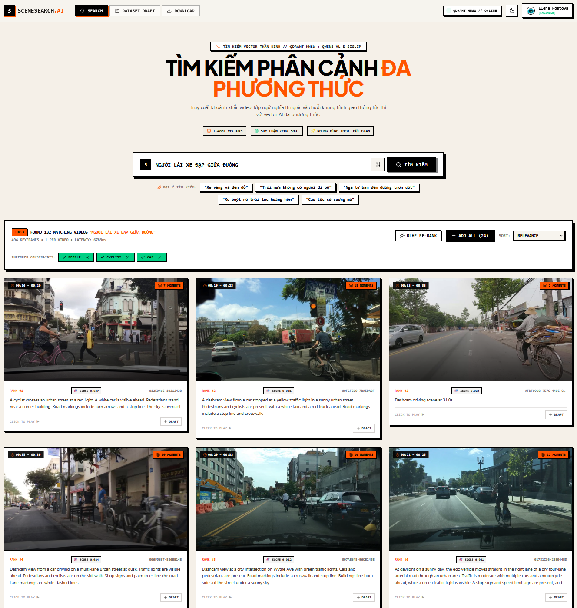

# 🚗 SceneSearch (P-081) — Multimodal Driving-Scene Search & Slicing Engine

> **Chạy Docker local trên Linux/NVIDIA:** xem [LOCAL_DOCKER.md](docs/LOCAL_DOCKER.md).
> Dùng `make local-up`, `make local-admin`, mở http://localhost:5173.
> Stack này dùng `docker-compose.local.yml` và dữ liệu local riêng.

[](LICENSE)
[](app/)
[](frontend/)
[](https://qdrant.tech/)
[](https://c3-app-081.vinai.io.vn/)
[-brightgreen.svg)](app/tests/)

> 🌐 **Official Domain (Live URL):** [https://c3-app-081.vinai.io.vn/](https://c3-app-081.vinai.io.vn/) *(Cloud Run: [https://scenesearch-604840409374.asia-southeast1.run.app](https://scenesearch-604840409374.asia-southeast1.run.app))*  
> 🎥 **Video Demo (5 Mins):** [Link Video Demo (Google Drive)](https://drive.google.com/file/d/1gXYMA_KUQKXAMoWqEM4tfmlxS2FZBpq8/view?usp=sharing)  
> 📊 **Pitch Deck Slides:** [Link Pitch Deck Slide (Google Drive)](https://drive.google.com/file/d/12VwYiEgA-HEAYQIE1Vo7gIWLeQOJIMpq/view?usp=sharing)  
> 🏛️ **Architecture Diagram:** [docs/architecture_diagram.md](docs/architecture_diagram.md) & [Interactive HTML](./docs/architecture.html)  
> 📈 **Evaluation Evidence:** [eval/results/report.md](eval/results/report.md)



---

## 1. Problem Statement (Vấn Đề)

Trong quá trình phát triển hệ thống xe tự hành (Autonomous Vehicles) và Robot điều hướng, các nhóm kỹ sư AI phải quản lý và huấn luyện trên hàng trăm Terabyte dữ liệu video camera hành trình (dashcam) từ các tập dữ liệu như Berkeley DeepDrive (BDD-100K) hay Waymo. Tuy nhiên:

1. **Truy tìm tình huống hiếm (Edge Cases) tốn nhiều nhân lực:** Kỹ sư mất hàng giờ tua video thủ công để tìm các tình huống đặc biệt (ví dụ: *xe cắt đầu ban đêm trời mưa, người đi bộ cầm dù qua đường, xe ưu tiên bật đèn chớp*).
2. **Khoảng cách biểu diễn ngữ nghĩa (Semantic Gap):** Câu truy vấn ngôn ngữ tự nhiên ngắn hoặc tiếng Việt thường không khớp trực tiếp với đặc trưng thị giác của các mô hình vision cơ bản.
3. **Tuân thủ quyền riêng tư (Privacy & GDPR):** Dữ liệu video dashcam công cộng chứa khuôn mặt người đi đường và biển số xe, tiềm ẩn rủi ro vi phạm pháp lý nếu không được làm mờ trước khi gán nhãn hoặc xuất khẩu.

---

## 2. Proposed Solution (Giải Pháp)

**SceneSearch (P-081)** là nền tảng tìm kiếm ngữ nghĩa đa phương thức và trích xuất lát cắt dữ liệu (Dataset Slicing Engine) chuyên dụng cho xe tự hành:

- 🔍 **Tìm kiếm đa ngôn ngữ tự nhiên (Natural Language Search):** Hỗ trợ câu truy vấn tiếng Việt và tiếng Anh (ví dụ: *"xe cứu hỏa bật đèn chớp ban đêm"*, *"ford minivan dừng đèn đỏ trời mưa"*), trích xuất chính xác đến từng mốc thời gian (0.5s timestamp).
- 🧠 **Tri-Tier Agentic Search & Visual-HyDE:** Tích hợp bộ phân loại OOD Guardrail chặn câu truy vấn rác, cơ chế Visual-HyDE mở rộng mô tả góc nhìn kính lái và vòng lặp phản tư (Reflection loop) tự động nới lỏng điều kiện khi gặp zero-hit.
- 🎭 **Tự động làm mờ khuôn mặt & biển số xe (Automated Anonymization - ADR-0003):** Quy trình 2-bucket bảo mật tuyệt đối, lưu video gốc trong `scenesearch-raw` và chỉ cung cấp khung hình đã ẩn danh bằng YOLOv8/Gaussian Blur trong `scencesearch-frames`.
- 📦 **Trích xuất phân đoạn Dataset (Dataset Slicing & JSONL Export):** Cho phép kỹ sư AI gom các phân đoạn tìm được vào khay bản nháp (Dataset Draft) và tải về file manifest `JSONL` kèm gói ảnh `ZIP` chuẩn hóa cho PyTorch / HuggingFace.
- ⏱️ **Giám sát thời gian thực (In-App APM Tracing):** Tích hợp công cụ Trace Explorer trong Admin với biểu đồ Gantt Waterfall phân tích chi tiết độ trễ từng micro-span (LLM, Embedding, Qdrant, Cache) trên bộ nhớ RAM.

---

## 3. Architecture & System Topology (Kiến Trúc Hệ Thống)



> 💡 **Xem phiên bản tương tác:** [Mở sơ đồ kiến trúc tương tác trực quan (Interactive Architecture Diagram)](./docs/architecture.html)  
> 📑 **Đặc tả kiến trúc chi tiết (Mermaid & Components):** [docs/architecture_diagram.md](docs/architecture_diagram.md)

### 3.1. Topology dịch vụ Multi-Container

```text
[ Frontend: React 19 + Tailwind CSS + Lucide ]  <── Port 80 (Nginx Ingress)
                     │
                     ▼ (Same-origin /api/* proxy)
[ Backend API: FastAPI + Pydantic v2 + SQLAlchemy 2 ]  <── Port 8000
       │                    │                     │
       ▼                    ▼                     ▼
[ AI Embedding Service ] [ Celery Worker ] [ In-Memory APM Tracer ]
  Qwen3-VL 2B (:8001)       FFmpeg + YOLO      Ring Buffer (RAM)
       │                    │
       ▼                    ▼
[ Qdrant Cloud ]     [ Cloud SQL Postgres ]  [ Upstash Redis ]  [ MinIO / GCS S3 ]
  2048d Collection     PostgreSQL 16           Broker & Cache     Two-Bucket Storage
```

### 3.2. Bảng phân nhiệm các dịch vụ (Services & Responsibilities)

| Dịch vụ (Service) | Trách nhiệm (Responsibility) | Địa chỉ mặc định |
| :--- | :--- | :--- |
| **Frontend** | Giao diện React 19 tìm kiếm, xem video seek tức thời, khay dataset, admin APM & benchmark | http://localhost:5173 (Dev) / Port 80 |
| **API** | Xác thực JWT, tìm kiếm Tri-Tier, proxy media an toàn, điều phối tác vụ ingest | http://localhost:8000 |
| **Embedding API** | Vi dịch vụ trích xuất đặc trưng đa phương thức Qwen3-VL-2B (2048d) & SigLIP (768d) | http://localhost:8001 |
| **Worker** | Ingestion pipeline (`pipelines.ingestion`): giải mã video, trích khung hình SSIM, YOLOv8 blur mặt & biển số | Nội bộ (Celery Daemon) |
| **PostgreSQL** | Lưu trữ người dùng, quyền RBAC, metadata corpus, tác vụ nền, đánh giá RLHF | localhost:5432 / Google Cloud SQL |
| **Redis** | Bộ nhớ đệm trạng thái tác vụ, message broker Celery và kết quả worker | localhost:6379 / Upstash Redis |
| **MinIO / GCS** | Lưu trữ phân tách 2-bucket: video gốc (`raw`) và khung hình phái sinh đã ẩn danh (`derived`) | http://localhost:9001 / GCS |
| **Qdrant** | Lưu trữ và tìm kiếm vector tương đồng cosine kết hợp bộ lọc payload HNSW | http://localhost:6333/dashboard |
| **LLM Reasoning** | NVIDIA NIM API (`moonshotai/kimi-k3`): phân loại OOD guardrail, sinh mô tả Visual-HyDE | Cloud API |

*Ghi chú cho macOS:* Chạy backing services trong Docker (`make docker-infra`) và chạy API/worker trực tiếp trên host để tận dụng Apple Silicon Metal (MPS) tăng tốc suy luận (ADR-0001).

---

## 4. Project Structure (Cấu Trúc Thư Mục Dự Án)

```text
SceneSearch-P-081/
|-- app/                            # Backend Python (flat package layout)
|   |-- api/main.py                 # FastAPI application và kiểm tra startup
|   |-- api/v1/                     # Endpoints: auth, search, ingest, media, admin, datasets
|   |-- core/                       # Settings, structured logging, JWT, APM tracer
|   |-- db/                         # SQLAlchemy models và Alembic migrations
|   |-- infrastructure/             # Adapters kết nối: Postgres, Redis, MinIO, Qdrant
|   |-- pipelines/ingestion/        # Ingest stages: decode, SSIM sample, YOLOv8 anonymize
|   |-- worker/                     # Celery app và ingest tasks
|   |-- search/                     # Engine tìm kiếm Tri-Tier, HyDE, catalog, write path
|   |-- services/                   # Business logic: auth, admin, dataset export
|   |-- ml/                         # Encoders: Qwen3-VL, SigLIP, remote client, anonymizer
|   |-- eval/                       # Retrieval evaluation harness & benchmark runner
|   |-- tests/                      # Unit tests, API contract tests, integration tests (421/421 PASS)
|-- frontend/                       # Frontend React 19 + Vite + Tailwind CSS
|   |-- src/components/             # Search bar, Video modal, Dataset tray, Admin Trace Explorer
|   |-- src/pages/                  # SearchPage, IngestPage, AdminPage, DatasetDraftPage
|   |-- nginx.conf                  # Nginx reverse proxy cho production container
|-- deploy/                         # Kịch bản triển khai production và GitHub Actions
|-- docs/                           # Tài liệu kỹ thuật: SRS, MVP, ADRs, hướng dẫn Cloud Run
|   |-- assest/                     # Hình ảnh kiến trúc (SVG), preview UI (PNG)
|   |-- architecture.html           # Sơ đồ kiến trúc tương tác (Interactive Diagram)
|   |-- architecture_diagram.md     # Đặc tả chi tiết kiến trúc dạng Mermaid
|   |-- SRS.md / MVP.md             # Yêu cầu hệ thống và tài liệu bàn giao
|   '-- adr/                        # Architecture Decision Records (ADR-0001 -> ADR-0005)
|-- eval/results/                   # Báo cáo kết quả đánh giá thực nghiệm (report.md)
|-- presentation/                   # Tài liệu thuyết trình, pitch deck và kịch bản demo
|-- scripts/                        # Utility scripts: seed_users.py, deploy-multicontainer.sh
|-- cloudrun-multicontainer.yaml    # Khai báo Pod 4 containers trên Google Cloud Run
|-- docker-compose.yml              # Local development stack
|-- docker-compose.deploy.yml       # Production stack triển khai local VM
|-- Makefile                        # Quản lý lệnh build, test, run, deploy
'-- README.md
```

Backend tuân thủ kiến trúc flat package: các import thực hiện từ thư mục gốc của `app/` (ví dụ: `from core.config import ...`).

---

## 5. Prerequisites & Local Setup (Cài Đặt & Chạy Thử)

### 5.1. Yêu cầu môi trường
- **Docker Engine / Docker Desktop** với Compose v2.
- **GNU Make**.
- Với môi trường host-native: **Python 3.11+**, **Node.js 20+**, **npm**.

### 5.2. Chạy nhanh toàn bộ hệ thống bằng Docker Compose (Khuyến nghị)

```bash
# 1. Sao chép cấu hình môi trường
cp app/.env.example app/.env

# 2. Khởi động toàn bộ cụm dịch vụ
make docker-up
```

API container tự động chạy Alembic migrations trước khi Uvicorn khởi động.

```bash
# Kiểm tra trạng thái và health check
docker compose --env-file app/.env ps
curl http://localhost:8000/health
```

**Các cổng dịch vụ mặc định:**
- **Frontend Web UI:** [http://localhost:5173](http://localhost:5173) (hoặc [http://localhost:80](http://localhost:80) với Docker prod)
- **API Swagger Docs:** [http://localhost:8000/docs](http://localhost:8000/docs)
- **MinIO Console:** [http://localhost:9001](http://localhost:9001)
- **Qdrant Dashboard:** [http://localhost:6333/dashboard](http://localhost:6333/dashboard)

Dừng hệ thống:
```bash
make docker-down
# Hoặc xóa bỏ hoàn toàn volume dữ liệu local:
docker compose --env-file app/.env down --volumes
```

### 5.3. Chạy trên môi trường Host (Local Development)

Phương án tối ưu trên macOS để tận dụng GPU Metal (MPS):

```bash
# Khởi chạy backing infrastructure trong Docker
make docker-infra

# Cài đặt thư viện backend & frontend
make install
make install-ml   # Cài đặt nếu ingest video hoặc encode query trực tiếp

# Áp dụng migration cơ sở dữ liệu
make migrate

# Khởi chạy 3 terminal riêng biệt:
make backend    # Terminal 1: FastAPI Uvicorn (:8000)
make worker     # Terminal 2: Celery Ingestion Worker
make frontend   # Terminal 3: React Vite (:5173)
```

Khởi tạo người dùng demo (admin/user):
```bash
cd app && .venv/bin/python ../scripts/seed_users.py
```

---

## 6. Configuration (Cấu Hình Môi Trường)

Toàn bộ cấu hình hệ thống được nạp từ biến môi trường và tệp `app/.env`. *Tuyệt đối không commit tệp `app/.env` lên kho mã nguồn.*

| Biến môi trường | Mục đích / Giá trị mẫu | Mặc định |
| :--- | :--- | :--- |
| `APP_ENV` | `development`, `test`, `staging`, hoặc `production` | `development` |
| `DATABASE_URL` | Chuỗi kết nối Async PostgreSQL | `postgresql+asyncpg://...` |
| `REDIS_URL` | Bộ nhớ cache trạng thái & Celery broker | `redis://localhost:6379/0` |
| `CELERY_BROKER_URL` | Broker hàng đợi tác vụ | `redis://localhost:6379/1` |
| `MINIO_ENDPOINT` | Host:port của S3/MinIO (không kèm tiền tố scheme) | `localhost:9000` |
| `MINIO_RAW_BUCKET` | Bucket lưu video gốc upload (không presign ra ngoài) | `scenesearch-raw` |
| `MINIO_DERIVED_BUCKET` | Bucket lưu khung hình phái sinh đã ẩn danh (bắt buộc khác raw - ADR-0003) | `scenesearch-derived` |
| `QDRANT_HOST` / `QDRANT_URL`| Địa chỉ Qdrant cluster nội bộ hoặc từ xa (kèm `:443` nếu HTTPS) | `localhost` |
| `QDRANT_COLLECTION` | Tên collection vector (Write path mặc định `scenes`, remote index Viettech là `Scences`) | `scenes` |
| `AUTH_SECRET_KEY` | Khóa bí mật ký JWT Token | Chuỗi ngẫu nhiên bảo mật |
| `QWEN_EMBEDDING_URL` | Địa chỉ microservice embedding Qwen3-VL | `http://localhost:8001` |
| `NVIDIA_API_KEY` | API Key NVIDIA NIM phục vụ LLM Guardrail & Visual-HyDE | `nvapi-...` |

---

## 7. API Guide (Hướng Dẫn Sử Dụng API)

Tất cả các route nghiệp vụ nằm dưới tiền tố `/api/v1`, ngoại trừ `GET /health`. Tìm kiếm là public; tải clip/thumbnail yêu cầu phiên đăng nhập; upload ingest và truy cập admin APM yêu cầu quyền Quản trị viên (Admin).

```bash
# 1. Health check hệ thống
curl http://localhost:8000/health

# 2. Đăng nhập lấy Bearer JWT Token
curl -X POST http://localhost:8000/api/v1/auth/login \
  -H "Content-Type: application/x-www-form-urlencoded" \
  -d "username=admin&password=adminpassword"

# 3. Tìm kiếm ngữ nghĩa bằng ngôn ngữ tự nhiên
curl -X POST http://localhost:8000/api/v1/search \
  -H "Content-Type: application/json" \
  -d '{"query": "xe cứu hỏa ban đêm bật đèn chớp", "limit": 10}'

# 4. Upload video mới vào hàng đợi xử lý (Yêu cầu Admin Token)
curl -X POST http://localhost:8000/api/v1/ingest/upload \
  -H "Authorization: Bearer <ADMIN_TOKEN>" \
  -F "file=@driving_clip.mp4"

# 5. Tra cứu trạng thái tiến độ tác vụ Ingest
curl -X GET http://localhost:8000/api/v1/tasks/<task-id>
```

---

## 8. Database Migrations (Quản Lý Schema Cơ Sở Dữ Liệu)

Sử dụng Alembic để kiểm soát phiên bản schema:

```bash
# Áp dụng migrations mới nhất
make migrate

# Tạo file migration tự động khi thay đổi SQLAlchemy models
make migration name=describe_change
```

*Lưu ý:* Khi chạy Docker Compose cục bộ, migrations tự động được áp dụng khi container API khởi động. Trên staging và production, migration được chạy như một release step độc lập.

---

## 9. Quality Assurance & Testing (Kiểm Thử & Đảm Bảo Chất Lượng)

Hệ thống đạt chuẩn kiểm thử toàn diện với **421/421 tests PASS (100%)**:

```bash
# Cập nhật và kiểm tra lockfile
make lock

# Chạy Ruff linter và format checker
make lint

# Chạy toàn bộ test suite pytest
make test

# Kiểm tra chất lượng tổng hợp (Lint + Test + Frontend Build)
make quality
```

**Cấu trúc bộ test:**
- `app/tests/unit/`: Kiểm thử logic độc lập (Tracer, Anonymizer, Embedder, Config).
- `app/tests/api/`: Kiểm thử hợp đồng HTTP endpoints, JWT Auth, Input validation.
- `app/tests/integration/`: Kiểm thử tích hợp kết nối Qdrant, PostgreSQL, Redis, MinIO.

CI/CD tự động chạy Ruff, Pytest (`.[dev,media]`), Frontend build và kiểm tra cú pháp Compose trên mọi Pull Request. Khi merge vào nhánh `main`, pipeline tự động kích hoạt deploy lên môi trường production an toàn.

---

## 10. Production Deployment (Triển Khai Google Cloud Run)

Hệ thống được tối ưu hóa triển khai trên **Google Cloud Run** theo mô hình kiến trúc **1-Service Multi-Container Pod**.

### 10.1. Triển khai 1 câu lệnh (Recommended)

```bash
make deploy
```

**Quy trình `make deploy` tự động thực thi:**
1. **Xác thực GCP:** Kích hoạt Service Account (`gcp-deployer-key.json`) và thiết lập project context (`vinai-infrastructure-505416`).
2. **Cloud Build song song:** Kích hoạt Google Cloud Build (`cloudbuild-fast.yaml`) với Docker layer caching và đẩy các immutable image đã gắn nhãn phiên bản lên Google Artifact Registry (`asia-southeast1`).
3. **Triển khai Cloud Run Pod:** Áp dụng tệp đặc tả [`cloudrun-multicontainer.yaml`](./cloudrun-multicontainer.yaml) thiết lập 4 containers cùng hoạt động dưới 1 endpoint HTTPS duy nhất:
   - **Frontend Ingress (`frontend`):** Nginx reverse proxy phục vụ UI React 19 trên Port 80 và chuyển tiếp cùng origin các truy vấn `/api/*`.
   - **API Server (`api`):** FastAPI trên Port 8000 xử lý tìm kiếm ngữ nghĩa, xác thực và điều phối tác vụ.
   - **Embedding Server (`embedding-api`):** Vi dịch vụ Qwen3-VL-2B chuyên dụng trên Port 8001.
   - **Background Worker (`worker`):** Celery ingestion daemon xử lý giải mã video, trích xuất SSIM và làm mờ khuôn mặt/biển số bằng YOLOv8.
4. **Tích hợp hạ tầng đám mây:** Tự động kết nối Cloud SQL (PostgreSQL), Upstash Redis, Qdrant Cloud cluster và MinIO/GCS object storage.

### 10.2. Các mục tiêu deploy khác

| Lệnh Make | Mục đích triển khai |
| :--- | :--- |
| `make deploy` | Triển khai hoàn chỉnh Cloud Build + Cloud Run Multi-Container |
| `make deploy-only` | Nạp cấu hình Cloud Run cập nhật tức thời mà không cần build lại ảnh |
| `make docker-deploy` | Khởi chạy stack production trên máy chủ ảo / VM nội bộ (Port 8088) |
| `make deploy-compose`| Triển khai Docker Compose production trên server từ xa |

---

## 11. Evaluation & Benchmarks (Kết Quả Đánh Giá Thực Nghiệm)

Hệ thống được đánh giá thực nghiệm toàn diện trên tập chuẩn **Golden Dataset (88 câu truy vấn kiểm thử chuyên sâu cho xe tự hành)** đối chiếu với 20GB video thực tế từ BDD-100K:

| Mô hình (Model) | Hit@1 | Hit@3 | Hit@5 | Hit@10 | Hit@50 | MRR Full | Frame-Level MRR |
| :--- | :---: | :---: | :---: | :---: | :---: | :---: | :---: |
| **Qwen3-VL Embedding 2B (Default)** | **73.86%** | **84.09%** | **89.77%** | **93.18%** | **96.59%** | **0.8016** | **0.518817** |
| **Hybrid (SigCLIP + Qwen)** | 61.36% | 73.86% | 81.82% | 88.64% | 96.59% | 0.6948 | 0.220510 |
| **SigCLIP (ViT-B-16 Baseline)** | 21.59% | 31.82% | 40.91% | 52.27% | 78.41% | 0.3012 | 0.071342 |

*Nhận xét:* Mô hình **Qwen3-VL-2B** cải thiện vượt bậc **+627% Frame-Level MRR** so với baseline SigCLIP đơn thuần nhờ khả năng hiểu ngữ cảnh không gian kính lái, nhận diện chính xác các câu truy vấn phức tạp bằng cả tiếng Việt và tiếng Anh.

👉 *Xem báo cáo đánh giá chi tiết và phân tích độ trễ tại:* [eval/results/report.md](eval/results/report.md).

---

## 12. Deliverables Checklist & Team (Checklist BTC & Nhóm)

### 📋 Checklist 9 Deliverables Bàn Giao Cho BTC
- [x] **1. Source Code (GitHub):** Mã nguồn hoàn chỉnh tại `app/` và `frontend/`, 421/421 unit tests PASS.
- [x] **2. README.md:** Tài liệu mô tả đầy đủ Problem → Solution → Architecture → Setup → Benchmarks → Team.
- [x] **3. Architecture Diagram:** Sơ đồ tương tác [`docs/architecture.html`](./docs/architecture.html), bản đồ họa [`docs/assest/architecture.svg`](./docs/assest/architecture.svg) và đặc tả Mermaid tại [`docs/architecture_diagram.md`](docs/architecture_diagram.md).
- [x] **4. Live URL / Deploy:** Hoạt động ổn định tại [https://c3-app-081.vinai.io.vn/](https://c3-app-081.vinai.io.vn/) *(hoặc [Cloud Run App](https://scenesearch-604840409374.asia-southeast1.run.app))*.
- [x] **5. Video Demo:** [Link Video Demo 5 Phút (Google Drive)](https://drive.google.com/file/d/1gXYMA_KUQKXAMoWqEM4tfmlxS2FZBpq8/view?usp=sharing) — Kịch bản chi tiết tại [`presentation/README.md`](presentation/README.md).
- [x] **6. Pitch Deck:** [Link Pitch Deck Slide (Google Drive)](https://drive.google.com/file/d/12VwYiEgA-HEAYQIE1Vo7gIWLeQOJIMpq/view?usp=sharing) — Dàn ý 10 slide tại [`presentation/README.md`](presentation/README.md).
- [x] **7. Weekly Journal:** Nhật ký 4 tuần phát triển tại [`JOURNAL.md`](JOURNAL.md).
- [x] **8. Worklog:** Nhật ký công việc hằng ngày tại [`WORKLOG.md`](WORKLOG.md).
- [x] **9. Evaluation Evidence:** Báo cáo thực nghiệm đầy đủ tại [`eval/results/report.md`](eval/results/report.md) (và [`EVALUATION.md`](EVALUATION.md)).

### 👥 Đội Ngũ Phát Triển (Team)
- **Mã dự án:** SceneSearch-P-081 (AI20K Cohort 3)
- **Tên miền:** `c3-app-081.vinai.io.vn`
- **Lĩnh vực:** Multimodal AI, Vector Search, Distributed Systems, Autonomous Driving Computer Vision.

---

## 13. Documentation & ADR Index (Tài Liệu Kỹ Thuật)

| Tài liệu | Vai trò và nội dung |
| :--- | :--- |
| [docs/SRS.md](docs/SRS.md) | Đặc tả yêu cầu phần mềm và trạng thái tính năng hiện tại |
| [docs/MVP.md](docs/MVP.md) | Tiêu chí bàn giao MVP, bài kiểm thử chấp nhận và roadmap |
| [docs/architecture_diagram.md](docs/architecture_diagram.md) | Sơ đồ Mermaid và đặc tả chi tiết kiến trúc microservices |
| [docs/DOCKER_GCLOUD_GUIDE.md](docs/DOCKER_GCLOUD_GUIDE.md) | Hướng dẫn vận hành Docker và triển khai GCP Cloud Run |
| [docs/AGENTIC_SEARCH.md](docs/AGENTIC_SEARCH.md) | Thiết kế thuật toán Tri-Tier Agentic Search, Visual-HyDE và Reflection |
| [docs/adr/ADR-0001-mps-acceleration.md](docs/adr/ADR-0001-mps-acceleration.md) | Lựa chọn tăng tốc Metal (MPS) trên Apple Silicon |
| [docs/adr/ADR-0002-two-bucket-storage.md](docs/adr/ADR-0002-two-bucket-storage.md) | Thiết kế 2-bucket lưu trữ bảo vệ quyền riêng tư người dùng |
| [docs/adr/ADR-0003-anonymization-pipeline.md](docs/adr/ADR-0003-anonymization-pipeline.md) | Quy trình tự động làm mờ khuôn mặt và biển số xe |
| [docs/adr/ADR-0004-granularity-and-dedup.md](docs/adr/ADR-0004-granularity-and-dedup.md) | Độ hạt phân đoạn video và thuật toán khử trùng lặp SSIM |
| [docs/adr/ADR-0005-corpus-selection.md](docs/adr/ADR-0005-corpus-selection.md) | Chính sách lựa chọn tập dữ liệu camera hành trình |

---

## 14. Development Conventions (Quy Ước Phát Triển)

- **HTTP Contracts:** Tất cả schemas được định nghĩa chặt chẽ bằng Pydantic trong `schemas/`. Router handler giữ vai trò điều hướng mỏng; toàn bộ nghiệp vụ nằm trong `services/`, `repositories/`, hoặc `pipelines/`.
- **Hạ tầng ngoại vi:** Chỉ giao tiếp với hệ thống bên ngoài thông qua các adapter trong `infrastructure/`.
- **Alembic:** Mọi thay đổi cấu trúc bảng cơ sở dữ liệu đều phải tạo migration qua Alembic.
- **Async Execution:** Sử dụng async trên các đường dẫn API; các SDK dạng blocking phải được chuyển vào worker thread (`asyncio.to_thread`) hoặc Celery background task.
- **Idempotency:** Các tác vụ Celery ingestion phải có tính bất biến/thực thi lặp lại an toàn (Idempotent).
- **Security:** Tuyệt đối không commit API keys, secrets, media cục bộ hoặc model weights vào git.

---

## 15. Troubleshooting (Xử Lý Sự Cố Thường Gặp)

- **Môi trường backend chưa cài đặt:** Chạy `make install` để khởi tạo `app/.venv`.
- **Trùng cổng dịch vụ (Port collision):** Stack sử dụng các cổng `5173`, `5432`, `6379`, `6333`, `6334`, `8000`, `8001`, `9000`, và `9001`. Tắt tiến trình xung đột hoặc cấu hình lại trong `app/.env`.
- **Kiểm tra logs hạ tầng:**
  ```bash
  docker compose --env-file app/.env ps
  docker compose --env-file app/.env logs postgres redis minio qdrant
  ```
- **Tác vụ bị treo ở hàng đợi (Tasks stuck queued):** Kiểm tra xem Celery worker có đang lắng nghe hàng đợi `ingestion` hay không:
  ```bash
  make worker
  # Hoặc trong Docker:
  docker compose --env-file app/.env logs worker
  ```
- **Lỗi khởi động MinIO Bucket:** `MINIO_RAW_BUCKET` và `MINIO_DERIVED_BUCKET` trùng tên nhau. Ứng dụng bắt buộc 2 bucket phải tách biệt để đảm bảo an toàn bảo mật (ADR-0003).
- **Lỗi Cold Start Qwen3-VL Embedding:** Container embedding mất 10-15s để tải weights mô hình khi khởi động lần đầu. Backend đã tích hợp cơ chế tự động ping warmup và retry với exponential backoff.
