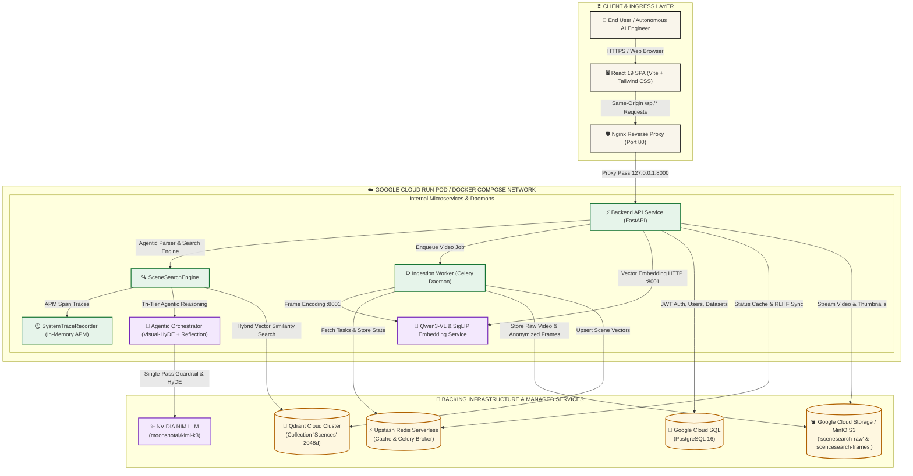
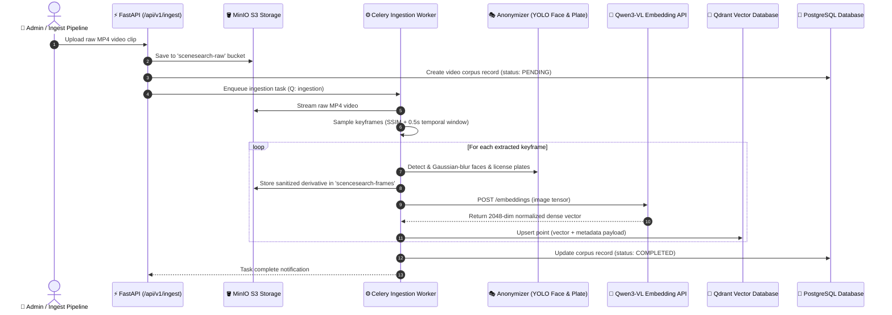
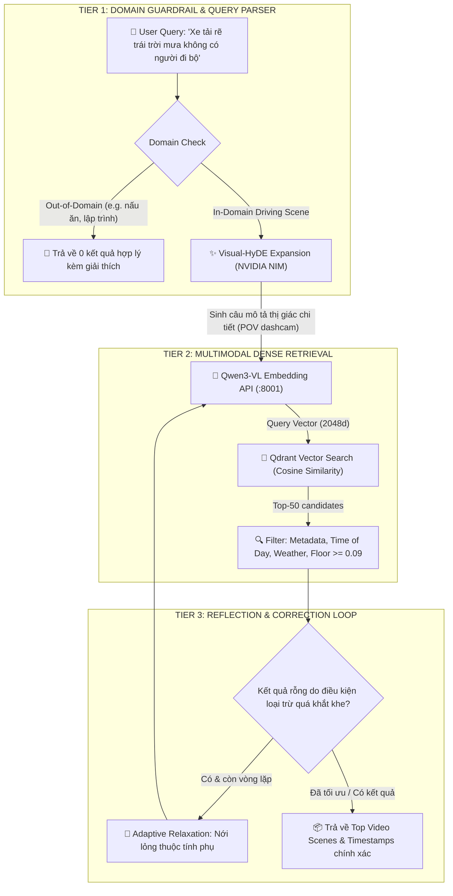

# SceneSearch (P-081) — System Architecture Diagram & Component Specifications

> 🌐 **Official Live Domain:** [https://c3-app-081.vinai.io.vn/](https://c3-app-081.vinai.io.vn/) *(Cloud Run: [https://scenesearch-604840409374.asia-southeast1.run.app](https://scenesearch-604840409374.asia-southeast1.run.app))*  
> 🎥 **Video Demo (5 Mins):** [https://drive.google.com/file/d/1gXYMA_KUQKXAMoWqEM4tfmlxS2FZBpq8/view?usp=sharing](https://drive.google.com/file/d/1gXYMA_KUQKXAMoWqEM4tfmlxS2FZBpq8/view?usp=sharing)  
> 📊 **Pitch Deck Slides:** [https://drive.google.com/file/d/12VwYiEgA-HEAYQIE1Vo7gIWLeQOJIMpq/view?usp=sharing](https://drive.google.com/file/d/12VwYiEgA-HEAYQIE1Vo7gIWLeQOJIMpq/view?usp=sharing)  

This document outlines the complete architectural design, data pipelines, multi-container microservice topology, and infrastructure components of **SceneSearch (P-081)** — an intelligent multimodal driving-scene search and video indexing platform.

---

## 1. High-Level System Architecture Diagram

---

## 2. Ingestion & Video Processing Pipeline

---

## 3. Tri-Tier Agentic Search Pipeline

---

## 4. Component Technical Specifications

| Component | Technology | Role & Responsibility | Resource Limits |
| :--- | :--- | :--- | :--- |
| **Frontend Web UI** | React 19, Vite, Tailwind CSS, Lucide | Giao diện tìm kiếm brutalist đa ngôn ngữ, trình phát video theo dõi timeline, trung tâm trích xuất dataset, APM trace explorer. | Nginx Ingress: 1 CPU, 1GB RAM |
| **Backend API Gateway** | FastAPI, Python 3.11, Pydantic v2, SQLAlchemy 2 | Quản lý định tuyến RESTful, xác thực JWT, điều phối Agentic Search, APM tracing, tích hợp Cloud SQL & Upstash. | 2 CPU, 6GB RAM |
| **Multimodal Embedding Service** | PyTorch, HuggingFace Transformers, Sentence-Transformers | Microservice chuyên dụng lưu trữ và thực thi mô hình `Qwen/Qwen3-VL-Embedding-2B` và `ViT-B-16-SigLIP`. | 4 CPU, 16GB RAM (hoặc GPU Tesla T4) |
| **Background Ingestion Worker** | Celery, FFmpeg, OpenCV, Ultralytics YOLO | Xử lý video bất đồng bộ, trích xuất khung hình thông minh SSIM, làm mờ mặt và biển số xe bảo vệ quyền riêng tư. | 1 CPU, 2GB RAM |
| **Relational Database** | PostgreSQL 16 (Google Cloud SQL) | Lưu trữ người dùng, phân quyền RBAC, metadata video, tập dữ liệu đánh giá, log phản hồi RLHF. | Google Cloud SQL Managed |
| **Vector Database** | Qdrant Cloud Cluster | Lưu trữ và tìm kiếm vector 2048 chiều (Qwen) và 768 chiều (SigLIP) với bộ lọc payload đa thuộc tính HNSW. | Viettech Cloud Cluster |
| **Object Storage** | MinIO / Google Cloud Storage | Phân tách bảo mật giữa video gốc (`scenesearch-raw`) và khung hình phái sinh đã ẩn danh (`scencesearch-frames`). | GCS S3-compatible |
| **Cache & Task Queue** | Redis (Upstash Serverless) | Lưu trạng thái tác vụ Celery, blacklisted JWT tokens, cache kết quả tìm kiếm nóng. | Upstash Redis TLS |
| **LLM Reasoning Agent** | NVIDIA NIM API (`moonshotai/kimi-k3`) | Phân loại OOD guardrail, sinh mô tả thị giác Visual-HyDE, trích xuất concept ràng buộc. | Serverless HTTPS |

---

## 5. Security & Privacy Architecture (ADR-0003)

- **Two-Bucket Isolation**: Video gốc chứa thông tin nhận dạng cá nhân (PII) được lưu riêng biệt trong bucket bảo mật `scenesearch-raw` (chỉ worker nội bộ truy cập). Khung hình hiển thị cho người dùng lưu trong `scencesearch-frames` và bắt buộc phải qua bước làm mờ tự động.
- **Stateless In-Memory APM Tracing**: Không ghi log thông tin nhạy cảm vào ổ đĩa; trace được lưu trữ trên ring buffer bộ nhớ RAM với cơ chế tự động xoay vòng 100 bản ghi gần nhất.
- **JWT Authentication & RBAC**: Phân quyền nghiêm ngặt 3 cấp độ: `admin` (toàn quyền upload, eval, telemetry), `engineer` (tìm kiếm, tạo draft, xuất dataset), và `annotator` (gắn nhãn RLHF).
