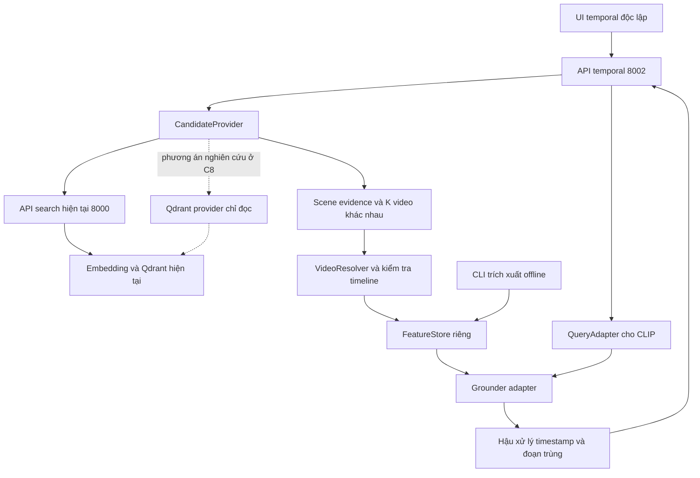

# A2 — Kiến trúc temporal độc lập

## Quyết định được chốt

Giữ luồng hiện tại theo working tree đã chụp. Nhánh mới không import entry point
FastAPI cũ vì startup đó có thể tạo schema, init collection/bucket và warm model.
Không đăng ký router mới vào backend hiện tại trong bản thử đầu.

Service mới dự kiến ở `127.0.0.1:8002`, UI thử nghiệm ở `127.0.0.1:5174`.
Đây là cổng dự kiến, chưa bind và phải kiểm tra xung đột khi triển khai.
Project Compose dự kiến `scenesearch-temporal` có file riêng trong nhánh mới.
Không sửa `docker-compose.local.yml`, Dockerfile, `.env`, Makefile hay frontend cũ.

## Các adapter và trách nhiệm

| Thành phần | Đầu vào/đầu ra | Ranh giới |
| --- | --- | --- |
| CandidateProvider | Query + filters + caller context -> scene evidence + video candidates + provenance | Không ghi vào Qdrant, không nới quyền caller |
| QueryAdapter | Query gốc + grounding_query -> query CLIP + ngôn ngữ + provenance | Giữ nguyên query truy hồi; không âm thầm dịch hoặc cắt query |
| VideoResolver | video_id + point evidence -> media identity + duration + origin + privacy_state | Không coi point_id là predicted moment_id; không trả key storage/credential |
| FeatureStore | media identity + feature version -> timestamped CLIP sequence | Cache riêng, không thay vector Qwen/SigLIP |
| Grounder | CLIP video/text features + masks -> predicted spans/saliency | QD-DETR/CG-DETR qua cùng interface; chưa chọn checkpoint cuối |
| Postprocessor | Spans + duration + retrieval ranks -> valid moments | Không cộng trực tiếp các thang điểm khác nhau |
| MediaAdapter | Approved asset + moment -> playback/thumbnail metadata | Trả URL theo origin rõ ràng, không URL thô đến bucket |

## N scene và K video

Provider mặc định cho bản thử là `legacy-api`, gọi `POST /api/v1/search` không
đổi default agentic/rerank/mode của luồng cũ. Limit/cursor hợp lệ dùng để lấy đủ
video; dừng khi đủ K, không còn cursor, upstream lỗi hoặc hết budget.

Provider giữ rank/score upstream và `matched_moments` làm evidence, khử trùng
scene ID và video ID. `scene_count_scope=returned_matched_moments` phải đi cùng
số scene quan sát được. `raw_ann_count=null` vì API cũ không cung cấp con số này.
Kết quả có thể có ít hơn K video, không thêm video không đạt điều kiện cho đủ số.

Với yêu cầu lấy chính xác top-N point trước khi gom video, cần provider
`qdrant-readonly` riêng ở C8. Nó phải tái sử dụng đúng encoder, named vectors,
filter và ngữ cảnh truy cập, đo recall trước khi chọn. Không mô tả legacy-api
như đã thực hiện raw ANN hoặc tự động chuyển provider khi API cũ từ chối request.

## Nguồn video, timeline và privacy

Grounding cần chuỗi video có timeline đã xác nhận, không chỉ thumbnail. Resolver
ưu tiên media hợp lệ của cùng video và ghi origin/duration thực. Nếu chỉ có
clip con thì phải có mapping về timeline gốc; thiếu mapping không dự đoán bằng
cách giả định origin bằng 0.

Moment dùng giây trên timeline nguồn, khoảng `[start, end)`, `0 <= start < end
<= duration`. Với media bắt đầu ở giây `origin`, vị trí player là `start-origin`.
Không dùng ID moment mới để gọi endpoint media cũ yêu cầu Qdrant point ID.

Playback hiện giữ hình ảnh nguồn. `privacy_state` phải là `source_preserving`,
`anonymized_verified` hoặc `unknown` theo bằng chứng, không theo tên bucket.
Việc sửa hành vi privacy cũ nằm ngoài nhóm A. Cache/thumbnail mới ghi provenance
nguồn và không nhận caption cũ như mô tả đã kiểm chứng của moment mới.

## Đặc trưng và cache

CLIP-only là cấu hình thử ban đầu. Phải khớp encoder, preprocessing, normalize,
token-level text features, mask và lưới thời gian checkpoint. Không thêm một
linear projection rồi coi Qwen/SigLIP đã tương thích checkpoint CLIP.

Lighthouse cấu hình QVHighlights clip 2 giây; CLIP video 512 chiều cộng 2 chiều
vị trí thời gian. API hiện có giới hạn 75 clip/150 giây; video dài dùng cửa sổ
chồng lấn và offset. Những tham số thực phải đọc từ checkpoint/adapter ở B6.
Không hứa độ chính xác dưới giây chỉ vì output là số thực.

Nguồn tham khảo để xác nhận ở nhóm B:
[feature config](https://github.com/line/lighthouse/blob/main/configs/feature/clip.yml),
[dataset config](https://github.com/line/lighthouse/blob/main/configs/dataset/qvhighlight.yml),
[predictor](https://github.com/line/lighthouse/blob/main/lighthouse/models.py).

Cache dự kiến chứa video fingerprint, media identity, encoder/checkpoint feature
version, timestamps, duration và trạng thái complete/failed. Ghi file tạm rồi
rename trong cùng volume, có cơ chế resume và invalidation; không dùng model
checkpoint ID như một phần thay thế video fingerprint.

## Tài nguyên và vận hành

- Model/cache/temporary files mới đặt dưới đường dẫn riêng trên E khi đủ chỗ.
  Chưa tạo thư mục hay chuyển dữ liệu ở E trong nhóm A. Docker image/VHDX vẫn
  cần kiểm tra vị trí lưu riêng, không suy ra đã ở E vì bind mount ở E.
- Bản đầu không tự nạp model lên GPU khi luồng cũ đang hoạt động. B6 đo CPU,
  GPU và chạy đồng thời; profile GPU chỉ bật sau khi có số liệu. Hàng đợi và
  concurrency mặc định 1 cho tác vụ nặng.
- Tách package/dependency của Lighthouse khỏi backend cũ. Không dùng Redis
  queue `ingestion`, không thêm worker vào stack cũ. Bản sync không cần Redis.
- Trong Docker, `localhost:8000` là chính container mới. Adapter dùng cổng host
  qua `host.docker.internal:8000` trên Docker Desktop sau khi kiểm tra reachability,
  hoặc network external đã tồn tại. Không sửa service/network cũ để thử kết nối.
- UI mới dùng proxy riêng đến API mới và media cũ, hoặc cấu hình origin tường
  minh. URL tương đối từ API 8000 phải resolve theo origin 8000, không theo 8002.
- Không tải đặc trưng toàn bộ kho hoặc train trong nhóm A. Benchmark full pipeline,
  cold/warm cache và ảnh hưởng latency cũ thuộc B6/E13.

## Auth và lỗi

Môi trường thử chỉ bind loopback. Chuyển tiếp bearer/cookie của caller tới upstream,
không lưu token và không thay bằng admin credential. Optional anonymous của local
chỉ được dùng khi phù hợp hành vi upstream; token không hợp lệ không được retry
anonymous. Trước khi expose ngoài local cần xác nhận chính sách thực ở B/nhóm D.

V1 sync có budget tổng, không tạo job giả. Cache thiếu được báo partial nếu còn
kết quả xử lý được, hoặc 503 nếu không thể xử lý video ứng viên nào. Không tự
chạy extraction/train trong request. 200 không chứa legacy fallback giả làm
grounding. Upstream 401/403 được giữ ý nghĩa, không chuyển thành no_match.

## Chuyển sang nhóm B

Chụp live baseline khi stack cũ sẵn sàng. Chuẩn bị nhãn độc lập và khảo sát model
theo paper/repo/checkpoint/train/hardware. Chạy checkpoint trên một số video,
đo latency/VRAM và kiểm tra timeline. Chỉ sau đó mới triển khai adapter, API và UI.
